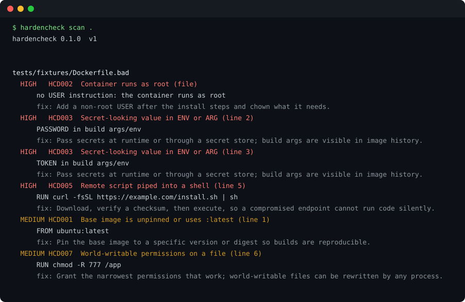

# hardencheck

**Static hardening checks for the files people actually ship: Dockerfiles, compose files, Kubernetes manifests and sshd config.** Zero dependencies, no network, SARIF output for CI.



[](https://github.com/mgkvibez/infra-hardening-checks/actions/workflows/ci.yml)
[](LICENSE)
[](pyproject.toml)

Repo name is `infra-hardening-checks`; the package and command are `hardencheck`, because `pipx install hardencheck` is what people should have to type.

## Install

```bash
pipx install git+https://github.com/mgkvibez/infra-hardening-checks.git
```

## Three ways to use it

```bash
# 1. A repo, before you push
hardencheck scan .

# 2. Only what blocks a release, as machine-readable output
hardencheck scan . --min-severity high --json

# 3. In CI, as SARIF that GitHub code scanning can ingest
hardencheck scan . --sarif > hardencheck.sarif
```

Exit codes are a contract: `0` nothing at or above the threshold, `3` findings, `2` a problem with the invocation. `hardencheck rules` lists the ruleset, `hardencheck explain HCD002` says why a rule exists and how to fix it.

## What it checks

21 rules across four kinds. High severity, the ones worth stopping a merge for:

| Id | Catches |
|---|---|
| HCD002 | Container runs as root |
| HCD003 | Secret-looking value in `ENV`/`ARG` |
| HCD005 | Remote script piped into a shell |
| HCC001 | `privileged: true` in compose |
| HCC002 | Docker socket mounted into a container |
| HCK001 | `privileged: true` in a pod spec |
| HCK003 | `hostPath` volume |
| HCS001 | `PermitRootLogin yes` |
| HCS003 | `PermitEmptyPasswords yes` |

Medium and low cover unpinned base images, missing `USER`, missing `HEALTHCHECK`, missing resource limits, `network_mode: host`, host namespaces, world-writable permissions and apt cache leftovers. Full list with severities: `hardencheck rules`.

## What it is not

It is a **lexical** checker, not a YAML parser and not a scanner. It reads lines, so it will miss anything that depends on real structure: anchors, merge keys, and values built by templating (Helm, Kustomize) are invisible to it. It flags patterns that are risky by policy, which means a deliberate `privileged: true` in a cluster-admin DaemonSet gets flagged too. Silence from this tool is not evidence of safety, which is why the clean result says `No issues found by ruleset v1` rather than "safe".

## How it works

- `hardencheck/rules.py` is the ruleset: each rule declares its id, severity, remediation and a function over lines. Adding a rule is one function and one entry.
- `hardencheck/scanner.py` decides a file's kind from its name and, for YAML, from its content, then runs only the matching rules. Unknown files are reported as skipped with the reason, never silently ignored.
- `hardencheck/report.py` renders text, JSON or SARIF 2.1.0.

## Contributing

Issues and PRs welcome. A new rule needs: an id in the existing scheme, a severity you can defend, remediation text a tired engineer can act on at 2am, and a fixture that proves the rule fires on bad input and stays silent on good input. `scripts/verify.sh` is the gate CI runs.

## License

MIT.
